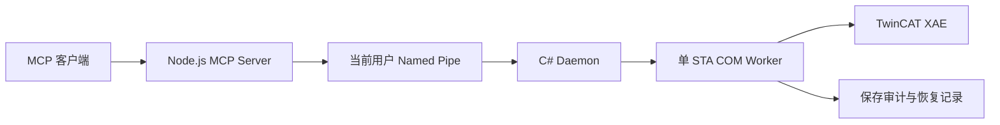

# TwinCAT XAE MCP

基于 Beckhoff TwinCAT 3 XAE Automation Interface 的本地 MCP Server。兼容客户端通过 XAE 工程模型读取和编辑 PLC 对象，由 XAE 维护 GUID 和工程引用，不直接生成 PLC XML。

## 功能

| 能力 | 当前状态 |
| --- | --- |
| 持久 XAE COM、单 STA 串行处理 | 已验证，会话由独立 Daemon 持有 |
| 工程树、声明和 ST 读取 | 已验证，支持中文路径 |
| ST FB 604、FB 直接子 Method 609 | 创建、修改、保存、重载及编译已验证 |
| STRUCT 606、ENUM 605、GVL 615 | 独立创建/修改、GUID/Compile 引用及编译已验证 |
| 保存审计、安全锁止、已审计保存恢复 | 离线及隔离 XAE 验证通过 |
| 正式只读与隔离 Dev、精确启动权限 | 已验证，权限由服务端配置决定 |
| 独立 Daemon、交互式 Windows 计划任务 | 同一登录会话的启动/复用/安全停止已验证 |
| ALIAS 623 | 硬禁用，保留失败现场，不重试 |

不提供 PLC 下载、在线控制、ADS 写入、配置激活、任意 DTE 命令或对象删除/移动/重命名。已有文件夹 Method 支持精确启动授权的 ST 更新，逐级验证 601 文件夹和 604 FB 归属；嵌套创建仍禁用。验收范围见 [嵌套方法](docs/NESTED_METHOD_VALIDATION.md)。部分上游 handler 保留用于维护比较，不代表已经开放。

## 架构



独立任务持有 Daemon/XAE。MCP 前端退出后重连已有管道，未知写入不重放，失效 COM Worker 不自动替换。

## 环境与构建

需要 Windows x64、交互桌面、Node.js 20+、Git、Windows PowerShell 5.1、.NET Framework 4.7.2 targeting pack/兼容运行时，以及 TwinCAT XAE 和 COM interop。真实验收版本为 XAE 3.1.4026.20 / `TcXaeShell.DTE.17.0`；其他版本需独立验证。常规操作不强制管理员权限。

在仓库根目录执行：

```powershell
npm ci
powershell.exe -NoProfile -ExecutionPolicy Bypass -File daemon/build.ps1 -OutputPath "$PWD\daemon\bin\Review"
$env:TE1000_DAEMON_EXE = "$PWD\daemon\bin\Review\Te1000Daemon.exe"
npm run check
npm test
npm run test:offline
node daemon/test-ping.js
```

构建默认 Release/x64。找不到 interop 时传 `-InteropPath '<TCatSysManagerLib.dll>'`。使用独立输出目录，不替换运行中的 Release；代码提交不代表部署。

## 配置与快速开始

1. 从 [只读模板](examples/nexplc-codex.toml) 或 [JSON 模板](examples/mcp-config.json) 配置精确 Solution、System Manager 项目、PLC 根和独立管道。默认禁用，替换所有占位符后再启用。
2. 正式条目 `nexplc_xae` 不配置写 Solution/Roots；保存和编译也被拒绝。
3. 隔离开发使用独立 linked Worktree、Dev EXE 和 `nexplc_xae_dev`。按 [开发流程](docs/DEVELOPMENT_WORKFLOW.md) 生成精确权限 Profile，再 [安装并启动任务](docs/XAE_LIFECYCLE.md)。
4. Dev MCP 从 Profile 复制完整 env，保持 `TE1000_DAEMON_AUTOSTART=0`。先调用 `xae {"action":"status"}` 核对精确 Solution 和身份。

客户端接入和规范加载见 [MCP 配置](docs/MCP_CONFIGURATION.md)。目前 Profile 生成器和保存/构建映射针对已验收的 NexPlc 布局，不支持直接套用于任意工程结构。

## PLC 编辑示例

以下为 `plc_pou` 参数；替换 `<PLC_ROOT>`，并先在 Dev 启动权限中列出目标对象。首次写入要求干净 Worktree。

```json
{"action":"create","parent":"<PLC_ROOT>^03_POUs","name":"FB_Example","subType":604,"language":1}
```

通过 `get_decl/get_impl` 读取代码及完整 `contentHash`，再更新：

```json
{"action":"set_impl","path":"<PLC_ROOT>^03_POUs^FB_Example","expectedHash":"<get_impl.contentHash>","implText":"nResult := 1;\n"}
```

依次调用 `project_save_preview {}`、`project_save {}`、`project_save_audit {}`，确认 safe/saved，检查 GUID、唯一 Compile 引用和完整 Git Diff。重载并离线编译，必要时再次审计保存。完整声明和其他类型参数见 [对象 API](docs/PLC_OBJECT_API.md)。

## 生命周期与安全

```powershell
$profileFile = '<LOCAL_PROFILE.json>'
& ./daemon/lifecycle.ps1 -Action install -Profile $profileFile -AtLogon
& ./daemon/lifecycle.ps1 -Action start -Profile $profileFile
& ./daemon/lifecycle.ps1 -Action status -Profile $profileFile
& ./daemon/lifecycle.ps1 -Action diagnose -Profile $profileFile
& ./daemon/lifecycle.ps1 -Action stop -Profile $profileFile
```

计划任务使用当前用户 InteractiveToken/LeastPrivilege，`-AtLogon` 可省略。PID/启动时间、SID/session、Solution、EXE、Named Pipe、策略和 owned lease 共同识别实例。stop 检查未保存内容和审计，只正常关闭自有 XAE。客户端不能扩权；raw pipe 同样受服务端限制。

不强制结束用户 XAE，不删 journal/lease 清锁。超时或断线先诊断，不重放写入。

## 测试与限制

[测试手册](docs/TESTING.md) 区分真实 XAE 和离线夹具。代表性真实离线编译为 0 错误、1 条既有第三方库警告。源码快照、日志及审计只留在本机。

未实测保证：注销/重新登录自动启动、真实 COM 写超时和晚返回、断电事务、长时间稳定性、GUI 并发编辑及所有崩溃路径。Profile 固定用户会话，新登录可能被保守拒绝。保存审计发生在写盘后，不是回滚、签名存储或文件事务。

## 文档

- [架构](docs/ARCHITECTURE.md)
- [对象 API](docs/PLC_OBJECT_API.md)
- [Daemon 生命周期](docs/XAE_LIFECYCLE.md)
- [保存与恢复安全](docs/XAE_SAVE_SAFETY.md)
- [MCP 配置](docs/MCP_CONFIGURATION.md)
- [开发流程](docs/DEVELOPMENT_WORKFLOW.md)
- [测试](docs/TESTING.md)
- [故障排查](docs/TROUBLESHOOTING.md)
- [ALIAS 故障专题](docs/ALIAS_API_VALIDATION.md)
- [Agent 规范](AGENTS.md)、[贡献说明](CONTRIBUTING.md)、[安全策略](SECURITY.md)、[示例](examples/README.md)

本 Fork 保留上游 Edge Automation 署名和 MIT 许可，见 [LICENSE](LICENSE) 与 [NOTICE](NOTICE)。
